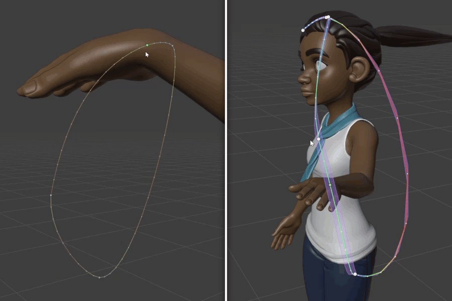
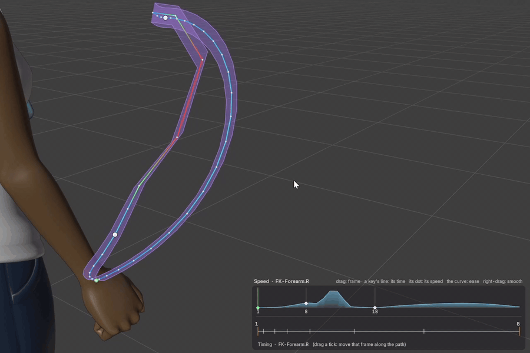
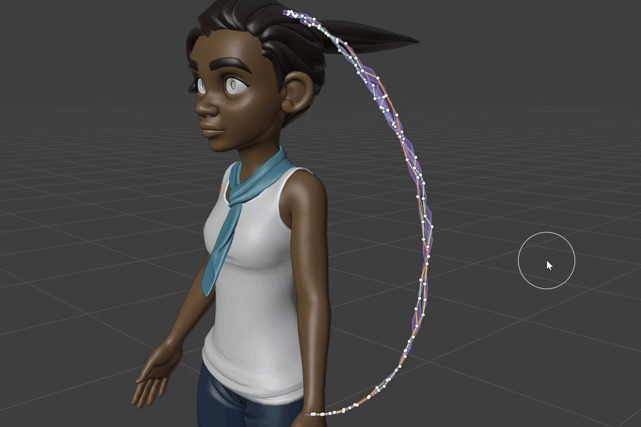

# Editable Motion Paths

**Edit animation like a mesh, right in the 3D view.** The motion of a bone or an object becomes
a curve you can grab: keys are points, handles are Bezier handles, and G / R / S, snapping,
proportional editing, extrude, knife and bevel work on it the way they do in Edit Mode. Every
change goes straight into the F-Curves - you may never open the Graph Editor again.

Free and open source, for Blender 4.4 and newer (tested on 4.4 and 5.2). Designed by an animator,
written by an AI - [How it was made](#how-it-was-made) · [Support the project](#support-the-project).

## What it does

**Shape the motion where you see it.** Click a key on the path, drag it, turn its handles, or
select a few and press G, R, S. Rotation paths trace the bone tip, with rotation rings like
Blender's gizmo; scale and custom values are drawn as ribbons and tracks along the path.
Several bones can be edited at once, like multi-object Edit Mode.

**Draw the timing.** A dot per frame shows the spacing; the speed graph and the timing chart
in the corner of the view can be dragged: pull a key's speed down for a slow-in, grab the curve
anywhere, set how far the change reaches with the mouse wheel, or right-drag to smooth out
bumps. The path keeps its shape and the keys stay on their frames.

**Sculpt it.** The *Sculpt Motion Path* tool has brushes for the shape (Grab, Smooth, Pinch)
and the timing (Slow, Fast, Even) - and **Dissolve**: one stroke over baked or mocap motion
removes every key the path doesn't need, keeping it within the tolerance you set.

**See what the motion does.** Onion-skin ghosts of the whole character update while you edit;
the path can be colored by speed or by a jitter heat map that finds hitches; the center of mass
shows whether a pose is balanced and whether a jump's arc is a parabola.

**Animator tools built in.** Easing presets with a live preview (P), Breakdown (blend a key
between the poses around it), Moving Hold, Scale Time, Offset Cascade for overlap (in the order
you pick the paths), Clean Up for baked keys, F-Curve modifiers as a stack, paths to curves and
back.

**Production-safe.** It only writes ordinary keys and handles - files open fine without the
add-on, undo works as usual. Tested on Blender Studio's production rig *Rain*, also linked as
a library override, with its constraints, drivers and IK.

**Ready for AI assistants.** A Python API lets an assistant such as Claude (through Blender MCP)
read the motion (`analyze`), see it (`render_view`) and edit it in world space - see
[AI_GUIDE.md](AI_GUIDE.md).

## Install

1. Download `editable_motion_paths-2.0.0.zip` from the [Releases](../../releases).
2. Blender: *Edit > Preferences > Get Extensions > Install from Disk…* and
   choose the zip.

## Quick start

1. Select a bone in Pose Mode (or an object), open the sidebar (**N**) > **Motion Paths** > **+**.
2. Press **Edit Paths** (or **Ctrl+T** in Pose Mode).
3. Click a key on the path and drag it - or use **G / R / S** like on a mesh.

| Key | What it does |
|---|---|
| Click, drag | select a key / handle, move it |
| **G / R / S** | move, rotate, scale keys (X / Y / Z, numbers, Ctrl: snap) |
| **G G** | slide keys along the path (T: in time) |
| **1 / 2 / 3 / 4** | Location / Rotation / Scale / Value paths |
| Ctrl+Click on the path | insert a key (the motion doesn't change) |
| **E**, **Ctrl+R**, **Ctrl+K**, **Ctrl+B** | extrude, loop cut, knife, bevel - like on a mesh |
| **Alt+S** / **Shift+E** | smooth / ease the selected keys |
| **P** | easing presets with a preview |
| **Shift+T** | Timing menu: Breakdown, Scale Time, Moving Hold, Offset Cascade... |
| **U** | display settings of the current mode |
| Right-click | path menu (on the speed graph: smooth the speed) |

Everything else - every tool, setting and hotkey - is in the **[manual](docs/MANUAL.md)**.

## Support the project

The add-on is free and will stay free. If it saves you time and you'd like to say thanks, I'd be
very grateful:

USDT (TRC20): `TUX1J4TEwDJNWNfjZUw6TocroKFPFz5B8F`

Bug reports and ideas help just as much - [open an issue](../../issues/new/choose); the form asks
for everything needed to track a bug down.

## How it was made

I want to be clear about this: I'm a 3D artist, not a programmer. I designed this add-on - what
it should do, how it should feel in the hands of an animator - and I tested every change in real
work, but I didn't write its code. The code, the tests and the documentation were written by
**Claude**, Anthropic's AI model, following my design and my feedback, change by change. So the
ideas and the decisions are mine, the development is Claude's.

## For developers

[AI_DEV_GUIDE.md](AI_DEV_GUIDE.md) explains how the add-on is built, its conventions and how to
test changes - written so that a person or an AI assistant can fork it and add features without
any other context.

## License

GPL-3.0-or-later, like Blender. The add-on's icons were made for it and are CC0.
